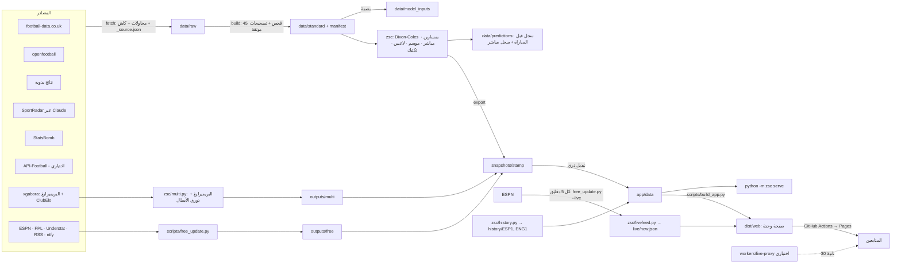

# البنية

## النسخة 3.1: المباشر والتشغيل الذاتي

| الجزء | المكان | القاعدة |
|---|---|---|
| ملف المباشر | `zsc/livefeed.py` ← `outputs/live/now.json` ← `app/data/live/now.json` | كل مباراة من ESPN تنربط برقمها الثابت عدنا (أسماء + موعد)، وإذا ما انربطت تنكتب بـ`unmatched` بدون تخمين؛ أرقام ثابتة للأحداث؛ إلغاءات الـVAR تنحفظ بـ`retracted`؛ تصحيح النتيجة بـ`score_history`؛ المجهول `null` |
| التحديث | `.github/workflows/update.yml` | المباشر كل 5 دقايق بأوقات المباريات (مكتبة Python القياسية بس)، والنشر بس إذا الملف تغيّر؛ التحديث الكامل يومياً؛ حالة المباشر بين التشغيلات بكاش Actions |
| البروكسي (اختياري) | `workers/live-proxy` | كاش مشترك 20 ثانية قدام ESPN لكل المتابعين |
| الواجهة المباشرة | `app/js/live.js` | يسأل ملف واحد (كل دقيقة وقت المباريات، كل 10 دقايق غيرها، ويوقف بالتبويب المخفي)؛ الاحتمالات المباشرة بموديل inplay-2.0؛ قراءة المباراة بقواعد ثابتة وكل سطر عليه نوع دليله |
| السجل التاريخي | `zsc/history.py`، `app/js/pages/lab.js` | مباريات الدوري بس؛ المواجهات بصفحة المباراة ومختبر التحقق |
| اللغات | `app/js/i18n.js` | العربي لغة الكود؛ الإنجليزي: اتجاه وتواريخ وأسماء فرق من المصدر، والنصوص تترجم وقت الرسم |
| التطبيق المثبت | `app/manifest.webmanifest`، `app/sw.js` | البيانات من الشبكة أول، والنسخة المحفوظة بس بدون إنترنت |

## الطبقات

| الطبقة | المكان | القاعدة |
|---|---|---|
| خام | `data/raw/<المصدر>/` | كما وصل، ما يتعدل؛ جنبه `_source.json` |
| موحدة | `data/standard/` | تنبني من الخام فقط (`python -m zsc data`)؛ فحوص؛ كتابة ذرية؛ نسخ احتياطية |
| مدخلات الموديل | `data/model_inputs/<بصمة>.csv.gz` | الجدول اللي تدرب عليه الموديل بالضبط |
| الموديلات والتقارير | `outputs/models/`، `reports/` | إعدادات كل مسار، سجل الإصدارات، التقييم |
| السجلات | `data/predictions/` | إضافة فقط |
| لقطة التطبيق | `snapshots/<stamp>/` ← `app/data/` | JSON ثابت، 69 ملف |
| بيانات المستخدم | `data/userdata/` (الخادم) أو المتصفح أو حساب Claude | منفصلة عن اللقطات، التحديث ما يمسها |

## وحدات Python (`zsc/`)

| الوحدة | الدور |
|---|---|
| `config.py`، `paths.py` | الإعدادات المركزية (الموسم، المسابقة، المنطقة الزمنية، المصادر) وكل المسارات؛ `.env` |
| `store.py`، `data.py` | جلب المصادر، قراءة ملفات football-data، بناء الطبقة الموحدة، الفحوص، الـmanifest، الحالة |
| `registry.py`، `teams.py` | المعرّفات الثابتة للفرق والمباريات والأسماء العربية |
| `dixon_coles.py`، `predict.py` | الموديل، المسارين، الشرح، العوامل |
| `backtest.py`، `evaluation.py`، `evaluate.py` | walk-forward، المقاييس، المعايرة، الفروق بمجالات ثقة |
| `inplay.py`، `inplay_fit.py`، `live.py` | الموديل المباشر وتقييمه، تقارير الأشواط |
| `simulate.py`، `standings.py`، `season.py`، `impact.py` | المحاكاة، كسر التعادل، التوقع، الأهمية، مدخلات «ماذا لو؟» |
| `predlog.py` | سجل التوقعات الإصدار 2 وتقييمه |
| `players.py`، `tactics.py`، `events.py`، `deep.py` | بيانات الأحداث: اللاعبين، التقييم العادل، المواجهات، الأرشيف |
| `stories.py` | القصص بدليلها |
| `apifootball.py` | التشكيلات والغيابات (بمفتاح، اختياري) |
| `multi.py` | **النسخة 3:** البريميرليغ (نفس موديل الليغا بمساريه) ودوري الأبطال (Elo + موديل أهداف + محاكاة مرحلة الدوري والإقصائيات)؛ فحوص الترتيب الرسمي؛ ملفات `c/<id>/` |
| `free_sources.py` | **النسخة 3:** محوّلات مجانية: ESPN، FPL، Understat، RSS، ntfy |
| `export.py` | لقطة التطبيق |
| `update.py`، `server.py`، `__main__.py` | التحديث الآمن، الخادم وواجهته، سطر الأوامر |

## الواجهة (`app/`)

جافاسكربت عادي بدون أدوات بناء؛ كل ملف يضيف لـ`window.ZS`:

| الملف | الدور |
|---|---|
| `js/core.js` | أدوات، تنسيق بالعربي وتوقيت بغداد، تحميل البيانات مع إعادة المحاولة، الحفظ (خادم / Claude / متصفح)، تحدي الجمهور، التنقل |
| `js/models.js` | نفس حسابات Python: مصفوفة Dixon-Coles، الموديل المباشر، محاكي الموسم (Web Worker) |
| `js/charts.js` | رسوم SVG: الخط الزمني التفاعلي، الخطوط، المعايرة، الأشرطة المتقابلة، الملعب (تسديدات، لمسات، تمريرات)، توزيع المراكز |
| `js/ui.js` | الأيقونات، الدروع، شريط الاحتمالات، بطاقة المباراة، الحالات (تحميل، خطأ، ناقص، قديم)، النوافذ |
| `js/pages/hub.js` | **النسخة 3:** المباريات حسب اليوم لكل البطولات (الصفحة الرئيسية)، الأخبار، البطولات، الترتيب، المزيد، صفحة مباراة وفريق للبريميرليغ والأبطال |
| `js/pages/*.js` | اليوم، المباريات حسب الجولة (`#round`)، مركز المباراة والأرشيف، الفرق، اللاعبين، الموسم، الاستوديو والتحدي، المنهجية والبيانات والإعدادات والتنبيهات |
| `js/main.js` | الإقلاع، القوائم، المظهر، الحالة، التنبيهات، التحديث التلقائي للبيانات |

**أوضاع التشغيل:** `server` (الخادم المحلي: الحفظ والتحدي بـ`/api`)، `artifact` (رابط Claude: الحفظ بقاعدة بيانات الرابط،
التنزيل بإذن)، `local` (صفحة ثابتة: الحفظ بالمتصفح). نفس الكود لكل الأوضاع؛ `scripts/build_app.py` يدمج CSS وJS بصفحة وحدة.

**التصميم:** عربي RTL؛ داكن افتراضي مع نهاري كامل؛ أخضر الملعب للموديل وأصفر لوحة النتائج للمباشر والتغييرات؛ الوقت
بالرسوم يمشي من اليمين لليسار؛ نتيجة صاحب الأرض جنب اسمه دائماً؛ من 320 بكسل، أهداف لمس 44 بكسل، كيبورد وتركيز ظاهر،
تقليل الحركة؛ الجداول الكبيرة تتمرر بمكانها.

## بيانات التطبيق (`app/data/`)

| الملف | المحتوى |
|---|---|
| `meta.json` | المنصة، الإصدارات، حالة البيانات والفحوص والنواقص والتصحيحات، المصادر، حالة الميزات، القاموس |
| `teams.json` | كل الفرق (المعرف، الاسم العربي والمختصر، الألوان) |
| `fixtures.json` | 380 مباراة: الحالة، النتيجة، التوقع المعروض والسابق، المسجل قبل البداية، الأهمية |
| `matches/mdNN.json` | مركز المباراة لكل جولة: المسارين، SportRadar، الأسباب، المدخلات، النتائج الأرجح، التاريخ، المباشر، الحقائق، التشكيلات |
| `season.json` | الترتيب، التوقع، التغييرات، التقييمات، مدخلات «ماذا لو؟»، الأهمية، القواعد |
| `teams/<ID>.json` | بطاقة الفريق |
| `accuracy.json` | ملخص التقييم والسجل الحي |
| `players.json`، `archive/*.json`، `stories.json` | اللاعبين، الأرشيف العميق، القصص |
| `comps.json` | **النسخة 3:** البطولات (المعرف، الاسم، اللون، مجلد البيانات) |
| `c/ENG1/*`، `c/UCL/*` | **النسخة 3:** `teams.json`، `fixtures.json` (توقع كل مباراة، النتائج الأرجح، مقارنة SportRadar)، `season.json` (الترتيب، المحاكاة، التقييمات أو Elo، الفحوص، التقييم) |
| `free/*` | **النسخة 3 (عند التشغيل خارج Claude):** غيابات FPL، لاعبي FPL، مباريات ESPN اليوم، xG من Understat، العناوين |

## من النسخة 1 (غير مستخدمة بالتطبيق الجديد)

`zsc/dashboard.py`، `zsc/tracking.py`، `zsc/forecast.py`، `zsc/online.py`، `run_forecast.py`،
`scripts/build_dashboard_data.py`، `scripts/dash_sync.py`، `scripts/build_notebook_v1.py` و`notebook/archive/`: مسار
الواجهة القديمة (Dashboard). باقية للمرجع ولاختباراتها؛ التطبيق والتحديث والمباشر بالنسخة 2 ما يعتمدون عليها.
